# dependency-map/group-1

[解析トップへ戻る](../../README.md)

このグループは表示用の区切りです。独立した実行モジュールではありません。

```mermaid
graph TD
    n-mobile-index-ts-fd77bf["index.ts\nmobile/index.ts"]
    n-mobile-src-navigation-index-tsx-7d497e["index.tsx\nmobile/src/navigation/index.tsx"]
    n-mobile-src-theme-index-ts-ae915f["index.ts\nmobile/src/theme/index.ts"]
    n-mobile-app-tsx-3eaacb["App.tsx\nmobile/App.tsx"]
    n-mobile-src-screens-insightsscreen-js-27025b["InsightsScreen.js\nmobile/src/screens/InsightsScreen.js"]
    n-mobile-src-screens-mapscreen-js-db5b13["MapScreen.js\nmobile/src/screens/MapScreen.js"]
    n-mobile-src-screens-alertsscreen-js-8ddb93["AlertsScreen.js\nmobile/src/screens/AlertsScreen.js"]
    n-mobile-src-screens-home-tsx-4a6654["Home.tsx\nmobile/src/screens/Home.tsx"]
```

## 要素の説明

### n-mobile-app-tsx-3eaacb

確認済みファイル: `mobile/App.tsx`

解析: 字句抽出。静的なimport／export参照です。関数の実行順序やHTTP通信は表していません。

宣言: `Root`, `App`

- `react` → 外部・標準ライブラリ・別名など。ローカル対応先は未確定
- `./src/contexts/AuthContext` → `mobile/src/contexts/AuthContext.tsx`（内容確認済み）
- `./src/contexts/FeedContext` → `mobile/src/contexts/FeedContext.tsx`（内容確認済み）
- `./src/contexts/RealEstateContext` → `mobile/src/contexts/RealEstateContext.tsx`（内容確認済み）
- `./src/screens/LoginScreen` → `mobile/src/screens/LoginScreen.tsx`（一覧確認・内容未読）
- `./src/screens/TestAuth` → `mobile/src/screens/TestAuth.tsx`（一覧確認・内容未読）
- `react-native-paper` → 外部・標準ライブラリ・別名など。ローカル対応先は未確定
- `./src/theme` → `mobile/src/theme/index.ts`（内容確認済み）
- `./src/navigation` → 外部・標準ライブラリ・別名など。ローカル対応先は未確定
- `@react-navigation/native` → 外部・標準ライブラリ・別名など。ローカル対応先は未確定

[詳細な図と説明を見る](n-mobile-app-tsx-3eaacb/README.md)

### n-mobile-index-ts-fd77bf

確認済みファイル: `mobile/index.ts`

解析: 字句抽出。静的なimport／export参照です。関数の実行順序やHTTP通信は表していません。

- `expo` → 外部・標準ライブラリ・別名など。ローカル対応先は未確定
- `./App` → `mobile/App.tsx`（内容確認済み）

[詳細な図と説明を見る](n-mobile-index-ts-fd77bf/README.md)

### n-mobile-src-navigation-index-tsx-7d497e

確認済みファイル: `mobile/src/navigation/index.tsx`

解析: 字句抽出。静的なimport／export参照です。関数の実行順序やHTTP通信は表していません。

宣言: `HomeStackNavigator`, `DiscoverStackNavigator`, `SavedStackNavigator`, `RootNavigator`

- `react` → 外部・標準ライブラリ・別名など。ローカル対応先は未確定
- `../screens/InsightsScreen` → `mobile/src/screens/InsightsScreen.js`（内容確認済み）
- `../screens/MapScreen` → `mobile/src/screens/MapScreen.js`（内容確認済み）
- `../screens/AlertsScreen` → `mobile/src/screens/AlertsScreen.js`（内容確認済み）
- `@react-navigation/bottom-tabs` → 外部・標準ライブラリ・別名など。ローカル対応先は未確定
- `@react-navigation/stack` → 外部・標準ライブラリ・別名など。ローカル対応先は未確定
- `@expo/vector-icons/MaterialIcons` → 外部・標準ライブラリ・別名など。ローカル対応先は未確定
- `../theme` → `mobile/src/theme/index.ts`（内容確認済み）
- `../screens/Home` → `mobile/src/screens/Home.tsx`（内容確認済み）
- `../screens/Saved` → `mobile/src/screens/Saved.tsx`（内容確認済み）
- `../screens/Profile` → `mobile/src/screens/Profile.tsx`（内容確認済み）
- `../screens/PropertySearchScreen` → `mobile/src/screens/PropertySearchScreen.tsx`（内容確認済み）
- `../screens/PropertySwipeScreen` → `mobile/src/screens/PropertySwipeScreen.tsx`（内容確認済み）
- `../screens/PropertyDetailScreen` → `mobile/src/screens/PropertyDetailScreen.tsx`（内容確認済み）

[詳細な図と説明を見る](n-mobile-src-navigation-index-tsx-7d497e/README.md)

### n-mobile-src-screens-alertsscreen-js-8ddb93

確認済みファイル: `mobile/src/screens/AlertsScreen.js`

解析: 字句抽出。静的なimport／export参照です。関数の実行順序やHTTP通信は表していません。

宣言: `AlertsScreen`

- `react` → 外部・標準ライブラリ・別名など。ローカル対応先は未確定
- `react-native` → 外部・標準ライブラリ・別名など。ローカル対応先は未確定
- `@expo/vector-icons/MaterialIcons` → 外部・標準ライブラリ・別名など。ローカル対応先は未確定
- `../theme` → `mobile/src/theme/index.ts`（内容確認済み）

[詳細な図と説明を見る](n-mobile-src-screens-alertsscreen-js-8ddb93/README.md)

### n-mobile-src-screens-home-tsx-4a6654

確認済みファイル: `mobile/src/screens/Home.tsx`

解析: 字句抽出。静的なimport／export参照です。関数の実行順序やHTTP通信は表していません。

宣言: `Home`

- `react` → 外部・標準ライブラリ・別名など。ローカル対応先は未確定
- `react-native` → 外部・標準ライブラリ・別名など。ローカル対応先は未確定
- `@react-navigation/native` → 外部・標準ライブラリ・別名など。ローカル対応先は未確定
- `@expo/vector-icons/MaterialIcons` → 外部・標準ライブラリ・別名など。ローカル対応先は未確定
- `../components/SwipeDeck` → `mobile/src/components/SwipeDeck.tsx`（一覧確認・内容未読）
- `../theme` → `mobile/src/theme/index.ts`（内容確認済み）

[詳細な図と説明を見る](n-mobile-src-screens-home-tsx-4a6654/README.md)

### n-mobile-src-screens-insightsscreen-js-27025b

確認済みファイル: `mobile/src/screens/InsightsScreen.js`

解析: 字句抽出。静的なimport／export参照です。関数の実行順序やHTTP通信は表していません。

宣言: `InsightsScreen`

- `react` → 外部・標準ライブラリ・別名など。ローカル対応先は未確定
- `react-native` → 外部・標準ライブラリ・別名など。ローカル対応先は未確定
- `../theme` → `mobile/src/theme/index.ts`（内容確認済み）

[詳細な図と説明を見る](n-mobile-src-screens-insightsscreen-js-27025b/README.md)

### n-mobile-src-screens-mapscreen-js-db5b13

確認済みファイル: `mobile/src/screens/MapScreen.js`

解析: 字句抽出。静的なimport／export参照です。関数の実行順序やHTTP通信は表していません。

宣言: `MapScreen`

- `react` → 外部・標準ライブラリ・別名など。ローカル対応先は未確定
- `react-native` → 外部・標準ライブラリ・別名など。ローカル対応先は未確定
- `../theme` → `mobile/src/theme/index.ts`（内容確認済み）

[詳細な図と説明を見る](n-mobile-src-screens-mapscreen-js-db5b13/README.md)

### n-mobile-src-theme-index-ts-ae915f

確認済みファイル: `mobile/src/theme/index.ts`

解析: 字句抽出。静的なimport／export参照です。関数の実行順序やHTTP通信は表していません。

- `react-native-paper` → 外部・標準ライブラリ・別名など。ローカル対応先は未確定

[詳細な図と説明を見る](n-mobile-src-theme-index-ts-ae915f/README.md)

