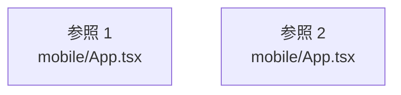

# dependency-map/group-1/n-mobile-app-tsx-3eaacb

[解析トップへ戻る](../../../README.md)

確認済みファイル: `mobile/App.tsx`

解析: 字句抽出。静的なimport／export参照です。関数の実行順序やHTTP通信は表していません。

宣言: `Root`, `App`

- `react` → 外部・標準ライブラリ・別名など。ローカル対応先は未確定
- `./src/contexts/AuthContext` → `mobile/src/contexts/AuthContext.tsx`（内容確認済み）
- `./src/contexts/FeedContext` → `mobile/src/contexts/FeedContext.tsx`（内容確認済み）
- `./src/contexts/RealEstateContext` → `mobile/src/contexts/RealEstateContext.tsx`（内容確認済み）
- `./src/screens/LoginScreen` → `mobile/src/screens/LoginScreen.tsx`（一覧確認・内容未読）
- `./src/screens/TestAuth` → `mobile/src/screens/TestAuth.tsx`（一覧確認・内容未読）
- `react-native-paper` → 外部・標準ライブラリ・別名など。ローカル対応先は未確定
- `./src/theme` → `mobile/src/theme/index.ts`（内容確認済み）
- `./src/navigation` → 外部・標準ライブラリ・別名など。ローカル対応先は未確定
- `@react-navigation/native` → 外部・標準ライブラリ・別名など。ローカル対応先は未確定

## 要素の説明

### imports-1

import参照の表示用グループ。

[詳細な図と説明を見る](imports-1/README.md)

### imports-2

import参照の表示用グループ。

[詳細な図と説明を見る](imports-2/README.md)

