# dependency-map/group-1/n-mobile-app-tsx-3eaacb/imports-1

[解析トップへ戻る](../../../../README.md)

import参照の表示用グループ。

```mermaid
graph TD
    source["ソース\nmobile/App.tsx"]
    n-react-6b810c["react\n外部・別名・未解決"]
    source -->|"字句抽出: import／export"| n-react-6b810c
    n-src-contexts-authcontext-487f2a["./src/contexts/AuthContext\nmobile/src/contexts/AuthContext.tsx"]
    source -->|"字句抽出: import／export"| n-src-contexts-authcontext-487f2a
    n-src-contexts-feedcontext-692859["./src/contexts/FeedContext\nmobile/src/contexts/FeedContext.tsx"]
    source -->|"字句抽出: import／export"| n-src-contexts-feedcontext-692859
    n-src-contexts-realestatecontext-1ff31d["./src/contexts/RealEstateContext\nmobile/src/contexts/RealEstateContext.tsx"]
    source -->|"字句抽出: import／export"| n-src-contexts-realestatecontext-1ff31d
    n-src-screens-loginscreen-4dc76c["./src/screens/LoginScreen\nmobile/src/screens/LoginScreen.tsx"]
    source -->|"字句抽出: import／export"| n-src-screens-loginscreen-4dc76c
    n-src-screens-testauth-080380["./src/screens/TestAuth\nmobile/src/screens/TestAuth.tsx"]
    source -->|"字句抽出: import／export"| n-src-screens-testauth-080380
    n-react-native-paper-1fb230["react-native-paper\n外部・別名・未解決"]
    source -->|"字句抽出: import／export"| n-react-native-paper-1fb230
    n-src-theme-9d2e0d["./src/theme\nmobile/src/theme/index.ts"]
    source -->|"字句抽出: import／export"| n-src-theme-9d2e0d
```

## 要素の説明

### n-react-6b810c

参照名: `react`

ローカルのソース対応先を確定できませんでした。外部ライブラリ、標準ライブラリ、型別名などを区別する追加確認が必要です。

### n-react-native-paper-1fb230

参照名: `react-native-paper`

ローカルのソース対応先を確定できませんでした。外部ライブラリ、標準ライブラリ、型別名などを区別する追加確認が必要です。

### n-src-contexts-authcontext-487f2a

参照名: `./src/contexts/AuthContext`

対応する実在ソース: `mobile/src/contexts/AuthContext.tsx`。内容確認済み。

### n-src-contexts-feedcontext-692859

参照名: `./src/contexts/FeedContext`

対応する実在ソース: `mobile/src/contexts/FeedContext.tsx`。内容確認済み。

### n-src-contexts-realestatecontext-1ff31d

参照名: `./src/contexts/RealEstateContext`

対応する実在ソース: `mobile/src/contexts/RealEstateContext.tsx`。内容確認済み。

### n-src-screens-loginscreen-4dc76c

参照名: `./src/screens/LoginScreen`

対応する実在ソース: `mobile/src/screens/LoginScreen.tsx`。内容は未読。

### n-src-screens-testauth-080380

参照名: `./src/screens/TestAuth`

対応する実在ソース: `mobile/src/screens/TestAuth.tsx`。内容は未読。

### n-src-theme-9d2e0d

参照名: `./src/theme`

対応する実在ソース: `mobile/src/theme/index.ts`。内容確認済み。

### source

`mobile/App.tsx` の内容を確認しました。

