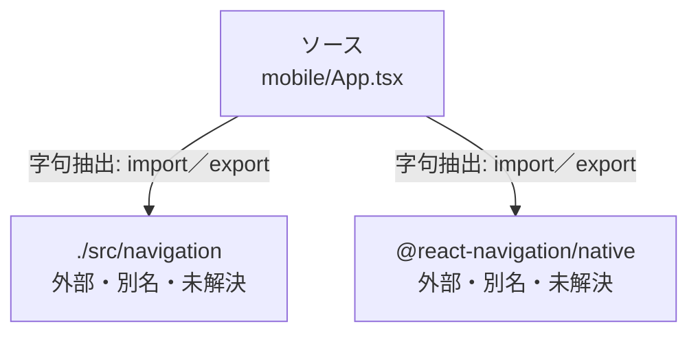

# dependency-map/group-1/n-mobile-app-tsx-3eaacb/imports-2

[解析トップへ戻る](../../../../README.md)

import参照の表示用グループ。

## 要素の説明

### n-react-navigation-native-f8232c

参照名: `@react-navigation/native`

ローカルのソース対応先を確定できませんでした。外部ライブラリ、標準ライブラリ、型別名などを区別する追加確認が必要です。

### n-src-navigation-27b15a

参照名: `./src/navigation`

ローカルのソース対応先を確定できませんでした。外部ライブラリ、標準ライブラリ、型別名などを区別する追加確認が必要です。

### source

`mobile/App.tsx` の内容を確認しました。

