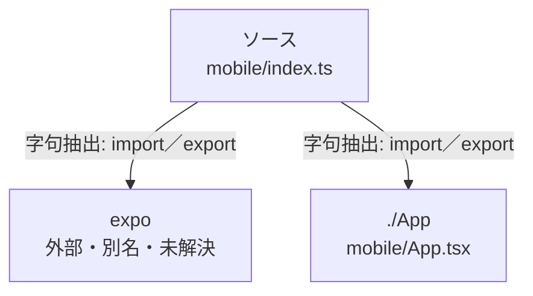

# dependency-map/group-1/n-mobile-index-ts-fd77bf

[解析トップへ戻る](../../../README.md)

確認済みファイル: `mobile/index.ts`

解析: 字句抽出。静的なimport／export参照です。関数の実行順序やHTTP通信は表していません。

- `expo` → 外部・標準ライブラリ・別名など。ローカル対応先は未確定
- `./App` → `mobile/App.tsx`（内容確認済み）

## 要素の説明

### n-app-4c727b

参照名: `./App`

対応する実在ソース: `mobile/App.tsx`。内容確認済み。

### n-expo-41f8b4

参照名: `expo`

ローカルのソース対応先を確定できませんでした。外部ライブラリ、標準ライブラリ、型別名などを区別する追加確認が必要です。

### source

`mobile/index.ts` の内容を確認しました。

