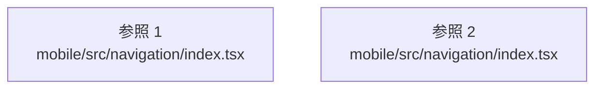

# dependency-map/group-1/n-mobile-src-navigation-index-tsx-7d497e

[解析トップへ戻る](../../../README.md)

確認済みファイル: `mobile/src/navigation/index.tsx`

解析: 字句抽出。静的なimport／export参照です。関数の実行順序やHTTP通信は表していません。

宣言: `HomeStackNavigator`, `DiscoverStackNavigator`, `SavedStackNavigator`, `RootNavigator`

- `react` → 外部・標準ライブラリ・別名など。ローカル対応先は未確定
- `../screens/InsightsScreen` → `mobile/src/screens/InsightsScreen.js`（内容確認済み）
- `../screens/MapScreen` → `mobile/src/screens/MapScreen.js`（内容確認済み）
- `../screens/AlertsScreen` → `mobile/src/screens/AlertsScreen.js`（内容確認済み）
- `@react-navigation/bottom-tabs` → 外部・標準ライブラリ・別名など。ローカル対応先は未確定
- `@react-navigation/stack` → 外部・標準ライブラリ・別名など。ローカル対応先は未確定
- `@expo/vector-icons/MaterialIcons` → 外部・標準ライブラリ・別名など。ローカル対応先は未確定
- `../theme` → `mobile/src/theme/index.ts`（内容確認済み）
- `../screens/Home` → `mobile/src/screens/Home.tsx`（内容確認済み）
- `../screens/Saved` → `mobile/src/screens/Saved.tsx`（内容確認済み）
- `../screens/Profile` → `mobile/src/screens/Profile.tsx`（内容確認済み）
- `../screens/PropertySearchScreen` → `mobile/src/screens/PropertySearchScreen.tsx`（内容確認済み）
- `../screens/PropertySwipeScreen` → `mobile/src/screens/PropertySwipeScreen.tsx`（内容確認済み）
- `../screens/PropertyDetailScreen` → `mobile/src/screens/PropertyDetailScreen.tsx`（内容確認済み）

## 要素の説明

### imports-1

import参照の表示用グループ。

[詳細な図と説明を見る](imports-1/README.md)

### imports-2

import参照の表示用グループ。

[詳細な図と説明を見る](imports-2/README.md)

