# dependency-map/group-1/n-mobile-src-navigation-index-tsx-7d497e/imports-1

[解析トップへ戻る](../../../../README.md)

import参照の表示用グループ。

```mermaid
graph TD
    source["ソース\nmobile/src/navigation/index.tsx"]
    n-react-6b810c["react\n外部・別名・未解決"]
    source -->|"字句抽出: import／export"| n-react-6b810c
    n-screens-insightsscreen-38bd86["../screens/InsightsScreen\nmobile/src/screens/InsightsScreen.js"]
    source -->|"字句抽出: import／export"| n-screens-insightsscreen-38bd86
    n-screens-mapscreen-052fa4["../screens/MapScreen\nmobile/src/screens/MapScreen.js"]
    source -->|"字句抽出: import／export"| n-screens-mapscreen-052fa4
    n-screens-alertsscreen-4c1580["../screens/AlertsScreen\nmobile/src/screens/AlertsScreen.js"]
    source -->|"字句抽出: import／export"| n-screens-alertsscreen-4c1580
    n-react-navigation-bottom-tabs-05a193["@react-navigation/bottom-tabs\n外部・別名・未解決"]
    source -->|"字句抽出: import／export"| n-react-navigation-bottom-tabs-05a193
    n-react-navigation-stack-31e7e2["@react-navigation/stack\n外部・別名・未解決"]
    source -->|"字句抽出: import／export"| n-react-navigation-stack-31e7e2
    n-expo-vector-icons-materialicons-70027f["@expo/vector-icons/MaterialIcons\n外部・別名・未解決"]
    source -->|"字句抽出: import／export"| n-expo-vector-icons-materialicons-70027f
    n-theme-aece7d["../theme\nmobile/src/theme/index.ts"]
    source -->|"字句抽出: import／export"| n-theme-aece7d
```

## 要素の説明

### n-expo-vector-icons-materialicons-70027f

参照名: `@expo/vector-icons/MaterialIcons`

ローカルのソース対応先を確定できませんでした。外部ライブラリ、標準ライブラリ、型別名などを区別する追加確認が必要です。

### n-react-6b810c

参照名: `react`

ローカルのソース対応先を確定できませんでした。外部ライブラリ、標準ライブラリ、型別名などを区別する追加確認が必要です。

### n-react-navigation-bottom-tabs-05a193

参照名: `@react-navigation/bottom-tabs`

ローカルのソース対応先を確定できませんでした。外部ライブラリ、標準ライブラリ、型別名などを区別する追加確認が必要です。

### n-react-navigation-stack-31e7e2

参照名: `@react-navigation/stack`

ローカルのソース対応先を確定できませんでした。外部ライブラリ、標準ライブラリ、型別名などを区別する追加確認が必要です。

### n-screens-alertsscreen-4c1580

参照名: `../screens/AlertsScreen`

対応する実在ソース: `mobile/src/screens/AlertsScreen.js`。内容確認済み。

### n-screens-insightsscreen-38bd86

参照名: `../screens/InsightsScreen`

対応する実在ソース: `mobile/src/screens/InsightsScreen.js`。内容確認済み。

### n-screens-mapscreen-052fa4

参照名: `../screens/MapScreen`

対応する実在ソース: `mobile/src/screens/MapScreen.js`。内容確認済み。

### n-theme-aece7d

参照名: `../theme`

対応する実在ソース: `mobile/src/theme/index.ts`。内容確認済み。

### source

`mobile/src/navigation/index.tsx` の内容を確認しました。

