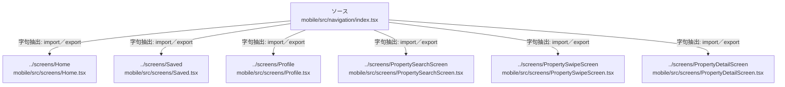

# dependency-map/group-1/n-mobile-src-navigation-index-tsx-7d497e/imports-2

[解析トップへ戻る](../../../../README.md)

import参照の表示用グループ。

## 要素の説明

### n-screens-home-a5308e

参照名: `../screens/Home`

対応する実在ソース: `mobile/src/screens/Home.tsx`。内容確認済み。

### n-screens-profile-c67f13

参照名: `../screens/Profile`

対応する実在ソース: `mobile/src/screens/Profile.tsx`。内容確認済み。

### n-screens-propertydetailscreen-348767

参照名: `../screens/PropertyDetailScreen`

対応する実在ソース: `mobile/src/screens/PropertyDetailScreen.tsx`。内容確認済み。

### n-screens-propertysearchscreen-fe2f65

参照名: `../screens/PropertySearchScreen`

対応する実在ソース: `mobile/src/screens/PropertySearchScreen.tsx`。内容確認済み。

### n-screens-propertyswipescreen-ccf375

参照名: `../screens/PropertySwipeScreen`

対応する実在ソース: `mobile/src/screens/PropertySwipeScreen.tsx`。内容確認済み。

### n-screens-saved-a73342

参照名: `../screens/Saved`

対応する実在ソース: `mobile/src/screens/Saved.tsx`。内容確認済み。

### source

`mobile/src/navigation/index.tsx` の内容を確認しました。

