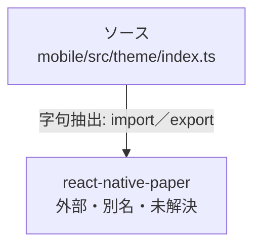

# dependency-map/group-1/n-mobile-src-theme-index-ts-ae915f

[解析トップへ戻る](../../../README.md)

確認済みファイル: `mobile/src/theme/index.ts`

解析: 字句抽出。静的なimport／export参照です。関数の実行順序やHTTP通信は表していません。

- `react-native-paper` → 外部・標準ライブラリ・別名など。ローカル対応先は未確定

## 要素の説明

### n-react-native-paper-1fb230

参照名: `react-native-paper`

ローカルのソース対応先を確定できませんでした。外部ライブラリ、標準ライブラリ、型別名などを区別する追加確認が必要です。

### source

`mobile/src/theme/index.ts` の内容を確認しました。

