# dependency-map/group-2

[解析トップへ戻る](../../README.md)

このグループは表示用の区切りです。独立した実行モジュールではありません。

```mermaid
graph TD
    n-mobile-src-screens-saved-tsx-bf6e53["Saved.tsx\nmobile/src/screens/Saved.tsx"]
    n-mobile-src-screens-profile-tsx-996deb["Profile.tsx\nmobile/src/screens/Profile.tsx"]
    n-mobile-src-screens-propertysearchscreen-tsx-8e7294["PropertySearchScreen.tsx\nmobile/src/screens/PropertySearchScreen.tsx"]
    n-mobile-src-screens-propertyswipescreen-tsx-633b38["PropertySwipeScreen.tsx\nmobile/src/screens/PropertySwipeScreen.tsx"]
    n-mobile-src-screens-propertydetailscreen-tsx-0f4332["PropertyDetailScreen.tsx\nmobile/src/screens/PropertyDetailScreen.tsx"]
    n-mobile-src-contexts-authcontext-tsx-a028fc["AuthContext.tsx\nmobile/src/contexts/AuthContext.tsx"]
    n-mobile-src-contexts-feedcontext-tsx-036d09["FeedContext.tsx\nmobile/src/contexts/FeedContext.tsx"]
    n-mobile-src-contexts-realestatecontext-tsx-c3db13["RealEstateContext.tsx\nmobile/src/contexts/RealEstateContext.tsx"]
```

## 要素の説明

### n-mobile-src-contexts-authcontext-tsx-a028fc

確認済みファイル: `mobile/src/contexts/AuthContext.tsx`

解析: 字句抽出。静的なimport／export参照です。関数の実行順序やHTTP通信は表していません。

- `react` → 外部・標準ライブラリ・別名など。ローカル対応先は未確定
- `expo-web-browser` → 外部・標準ライブラリ・別名など。ローカル対応先は未確定
- `expo-auth-session/providers/google` → 外部・標準ライブラリ・別名など。ローカル対応先は未確定
- `../lib/supabase` → `mobile/src/lib/supabase.ts`（一覧確認・内容未読）
- `@supabase/supabase-js` → 外部・標準ライブラリ・別名など。ローカル対応先は未確定

[詳細な図と説明を見る](n-mobile-src-contexts-authcontext-tsx-a028fc/README.md)

### n-mobile-src-contexts-feedcontext-tsx-036d09

確認済みファイル: `mobile/src/contexts/FeedContext.tsx`

解析: 字句抽出。静的なimport／export参照です。関数の実行順序やHTTP通信は表していません。

- `react` → 外部・標準ライブラリ・別名など。ローカル対応先は未確定
- `../lib/supabase` → `mobile/src/lib/supabase.ts`（一覧確認・内容未読）
- `./AuthContext` → `mobile/src/contexts/AuthContext.tsx`（内容確認済み）

[詳細な図と説明を見る](n-mobile-src-contexts-feedcontext-tsx-036d09/README.md)

### n-mobile-src-contexts-realestatecontext-tsx-c3db13

確認済みファイル: `mobile/src/contexts/RealEstateContext.tsx`

解析: 字句抽出。静的なimport／export参照です。関数の実行順序やHTTP通信は表していません。

- `react` → 外部・標準ライブラリ・別名など。ローカル対応先は未確定
- `../services/RealEstateAPI` → `mobile/src/services/RealEstateAPI.ts`（一覧確認・内容未読）
- `../services/LifullHomesAPI` → `mobile/src/services/LifullHomesAPI.ts`（一覧確認・内容未読）
- `./AuthContext` → `mobile/src/contexts/AuthContext.tsx`（内容確認済み）
- `../lib/supabase` → `mobile/src/lib/supabase.ts`（一覧確認・内容未読）
- `react-native` → 外部・標準ライブラリ・別名など。ローカル対応先は未確定

[詳細な図と説明を見る](n-mobile-src-contexts-realestatecontext-tsx-c3db13/README.md)

### n-mobile-src-screens-profile-tsx-996deb

確認済みファイル: `mobile/src/screens/Profile.tsx`

解析: 字句抽出。静的なimport／export参照です。関数の実行順序やHTTP通信は表していません。

宣言: `Profile`

- `react` → 外部・標準ライブラリ・別名など。ローカル対応先は未確定
- `react-native` → 外部・標準ライブラリ・別名など。ローカル対応先は未確定
- `../contexts/AuthContext` → `mobile/src/contexts/AuthContext.tsx`（内容確認済み）

[詳細な図と説明を見る](n-mobile-src-screens-profile-tsx-996deb/README.md)

### n-mobile-src-screens-propertydetailscreen-tsx-0f4332

確認済みファイル: `mobile/src/screens/PropertyDetailScreen.tsx`

解析: 字句抽出。静的なimport／export参照です。関数の実行順序やHTTP通信は表していません。

宣言: `PropertyDetailScreen`

- `react` → 外部・標準ライブラリ・別名など。ローカル対応先は未確定
- `react-native` → 外部・標準ライブラリ・別名など。ローカル対応先は未確定
- `@react-navigation/native` → 外部・標準ライブラリ・別名など。ローカル対応先は未確定
- `../theme` → `mobile/src/theme/index.ts`（内容確認済み）
- `@expo/vector-icons/MaterialIcons` → 外部・標準ライブラリ・別名など。ローカル対応先は未確定
- `../services/RealEstateAPI` → `mobile/src/services/RealEstateAPI.ts`（一覧確認・内容未読）
- `../contexts/RealEstateContext` → `mobile/src/contexts/RealEstateContext.tsx`（内容確認済み）

[詳細な図と説明を見る](n-mobile-src-screens-propertydetailscreen-tsx-0f4332/README.md)

### n-mobile-src-screens-propertysearchscreen-tsx-8e7294

確認済みファイル: `mobile/src/screens/PropertySearchScreen.tsx`

解析: 字句抽出。静的なimport／export参照です。関数の実行順序やHTTP通信は表していません。

宣言: `PropertySearchScreen`

- `react` → 外部・標準ライブラリ・別名など。ローカル対応先は未確定
- `react-native` → 外部・標準ライブラリ・別名など。ローカル対応先は未確定
- `@react-navigation/native` → 外部・標準ライブラリ・別名など。ローカル対応先は未確定
- `../theme` → `mobile/src/theme/index.ts`（内容確認済み）
- `../contexts/RealEstateContext` → `mobile/src/contexts/RealEstateContext.tsx`（内容確認済み）
- `@expo/vector-icons/MaterialIcons` → 外部・標準ライブラリ・別名など。ローカル対応先は未確定
- `../services/RealEstateAPI` → `mobile/src/services/RealEstateAPI.ts`（一覧確認・内容未読）

[詳細な図と説明を見る](n-mobile-src-screens-propertysearchscreen-tsx-8e7294/README.md)

### n-mobile-src-screens-propertyswipescreen-tsx-633b38

確認済みファイル: `mobile/src/screens/PropertySwipeScreen.tsx`

解析: 字句抽出。静的なimport／export参照です。関数の実行順序やHTTP通信は表していません。

宣言: `PropertySwipeScreen`

- `react` → 外部・標準ライブラリ・別名など。ローカル対応先は未確定
- `react-native` → 外部・標準ライブラリ・別名など。ローカル対応先は未確定
- `@react-navigation/native` → 外部・標準ライブラリ・別名など。ローカル対応先は未確定
- `../theme` → `mobile/src/theme/index.ts`（内容確認済み）
- `../contexts/RealEstateContext` → `mobile/src/contexts/RealEstateContext.tsx`（内容確認済み）
- `@expo/vector-icons/MaterialIcons` → 外部・標準ライブラリ・別名など。ローカル対応先は未確定
- `../services/RealEstateAPI` → `mobile/src/services/RealEstateAPI.ts`（一覧確認・内容未読）

[詳細な図と説明を見る](n-mobile-src-screens-propertyswipescreen-tsx-633b38/README.md)

### n-mobile-src-screens-saved-tsx-bf6e53

確認済みファイル: `mobile/src/screens/Saved.tsx`

解析: 字句抽出。静的なimport／export参照です。関数の実行順序やHTTP通信は表していません。

宣言: `SavedScreen`

- `react` → 外部・標準ライブラリ・別名など。ローカル対応先は未確定
- `@react-navigation/native` → 外部・標準ライブラリ・別名など。ローカル対応先は未確定
- `react-native` → 外部・標準ライブラリ・別名など。ローカル対応先は未確定
- `../contexts/FeedContext` → `mobile/src/contexts/FeedContext.tsx`（内容確認済み）
- `../contexts/RealEstateContext` → `mobile/src/contexts/RealEstateContext.tsx`（内容確認済み）
- `../theme` → `mobile/src/theme/index.ts`（内容確認済み）

[詳細な図と説明を見る](n-mobile-src-screens-saved-tsx-bf6e53/README.md)

