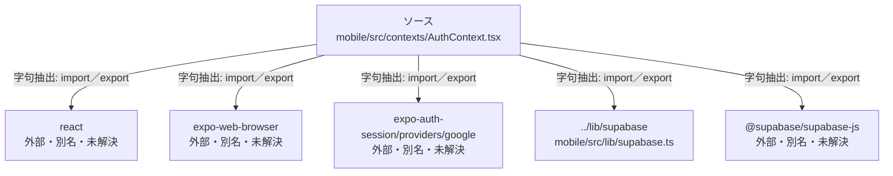

# dependency-map/group-2/n-mobile-src-contexts-authcontext-tsx-a028fc

[解析トップへ戻る](../../../README.md)

確認済みファイル: `mobile/src/contexts/AuthContext.tsx`

解析: 字句抽出。静的なimport／export参照です。関数の実行順序やHTTP通信は表していません。

- `react` → 外部・標準ライブラリ・別名など。ローカル対応先は未確定
- `expo-web-browser` → 外部・標準ライブラリ・別名など。ローカル対応先は未確定
- `expo-auth-session/providers/google` → 外部・標準ライブラリ・別名など。ローカル対応先は未確定
- `../lib/supabase` → `mobile/src/lib/supabase.ts`（一覧確認・内容未読）
- `@supabase/supabase-js` → 外部・標準ライブラリ・別名など。ローカル対応先は未確定

## 要素の説明

### n-expo-auth-session-providers-google-f6e8a0

参照名: `expo-auth-session/providers/google`

ローカルのソース対応先を確定できませんでした。外部ライブラリ、標準ライブラリ、型別名などを区別する追加確認が必要です。

### n-expo-web-browser-3add3a

参照名: `expo-web-browser`

ローカルのソース対応先を確定できませんでした。外部ライブラリ、標準ライブラリ、型別名などを区別する追加確認が必要です。

### n-lib-supabase-1ab51b

参照名: `../lib/supabase`

対応する実在ソース: `mobile/src/lib/supabase.ts`。内容は未読。

### n-react-6b810c

参照名: `react`

ローカルのソース対応先を確定できませんでした。外部ライブラリ、標準ライブラリ、型別名などを区別する追加確認が必要です。

### n-supabase-supabase-js-df00b1

参照名: `@supabase/supabase-js`

ローカルのソース対応先を確定できませんでした。外部ライブラリ、標準ライブラリ、型別名などを区別する追加確認が必要です。

### source

`mobile/src/contexts/AuthContext.tsx` の内容を確認しました。

