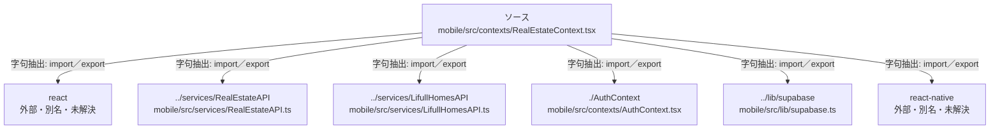

# dependency-map/group-2/n-mobile-src-contexts-realestatecontext-tsx-c3db13

[解析トップへ戻る](../../../README.md)

確認済みファイル: `mobile/src/contexts/RealEstateContext.tsx`

解析: 字句抽出。静的なimport／export参照です。関数の実行順序やHTTP通信は表していません。

- `react` → 外部・標準ライブラリ・別名など。ローカル対応先は未確定
- `../services/RealEstateAPI` → `mobile/src/services/RealEstateAPI.ts`（一覧確認・内容未読）
- `../services/LifullHomesAPI` → `mobile/src/services/LifullHomesAPI.ts`（一覧確認・内容未読）
- `./AuthContext` → `mobile/src/contexts/AuthContext.tsx`（内容確認済み）
- `../lib/supabase` → `mobile/src/lib/supabase.ts`（一覧確認・内容未読）
- `react-native` → 外部・標準ライブラリ・別名など。ローカル対応先は未確定

## 要素の説明

### n-authcontext-40a192

参照名: `./AuthContext`

対応する実在ソース: `mobile/src/contexts/AuthContext.tsx`。内容確認済み。

### n-lib-supabase-1ab51b

参照名: `../lib/supabase`

対応する実在ソース: `mobile/src/lib/supabase.ts`。内容は未読。

### n-react-6b810c

参照名: `react`

ローカルのソース対応先を確定できませんでした。外部ライブラリ、標準ライブラリ、型別名などを区別する追加確認が必要です。

### n-react-native-5c4a38

参照名: `react-native`

ローカルのソース対応先を確定できませんでした。外部ライブラリ、標準ライブラリ、型別名などを区別する追加確認が必要です。

### n-services-lifullhomesapi-bdd877

参照名: `../services/LifullHomesAPI`

対応する実在ソース: `mobile/src/services/LifullHomesAPI.ts`。内容は未読。

### n-services-realestateapi-56973a

参照名: `../services/RealEstateAPI`

対応する実在ソース: `mobile/src/services/RealEstateAPI.ts`。内容は未読。

### source

`mobile/src/contexts/RealEstateContext.tsx` の内容を確認しました。

