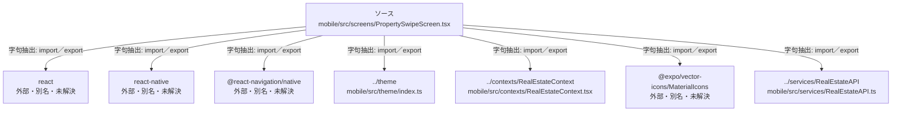

# dependency-map/group-2/n-mobile-src-screens-propertyswipescreen-tsx-633b38

[解析トップへ戻る](../../../README.md)

確認済みファイル: `mobile/src/screens/PropertySwipeScreen.tsx`

解析: 字句抽出。静的なimport／export参照です。関数の実行順序やHTTP通信は表していません。

宣言: `PropertySwipeScreen`

- `react` → 外部・標準ライブラリ・別名など。ローカル対応先は未確定
- `react-native` → 外部・標準ライブラリ・別名など。ローカル対応先は未確定
- `@react-navigation/native` → 外部・標準ライブラリ・別名など。ローカル対応先は未確定
- `../theme` → `mobile/src/theme/index.ts`（内容確認済み）
- `../contexts/RealEstateContext` → `mobile/src/contexts/RealEstateContext.tsx`（内容確認済み）
- `@expo/vector-icons/MaterialIcons` → 外部・標準ライブラリ・別名など。ローカル対応先は未確定
- `../services/RealEstateAPI` → `mobile/src/services/RealEstateAPI.ts`（一覧確認・内容未読）

## 要素の説明

### n-contexts-realestatecontext-b4d36f

参照名: `../contexts/RealEstateContext`

対応する実在ソース: `mobile/src/contexts/RealEstateContext.tsx`。内容確認済み。

### n-expo-vector-icons-materialicons-70027f

参照名: `@expo/vector-icons/MaterialIcons`

ローカルのソース対応先を確定できませんでした。外部ライブラリ、標準ライブラリ、型別名などを区別する追加確認が必要です。

### n-react-6b810c

参照名: `react`

ローカルのソース対応先を確定できませんでした。外部ライブラリ、標準ライブラリ、型別名などを区別する追加確認が必要です。

### n-react-native-5c4a38

参照名: `react-native`

ローカルのソース対応先を確定できませんでした。外部ライブラリ、標準ライブラリ、型別名などを区別する追加確認が必要です。

### n-react-navigation-native-f8232c

参照名: `@react-navigation/native`

ローカルのソース対応先を確定できませんでした。外部ライブラリ、標準ライブラリ、型別名などを区別する追加確認が必要です。

### n-services-realestateapi-56973a

参照名: `../services/RealEstateAPI`

対応する実在ソース: `mobile/src/services/RealEstateAPI.ts`。内容は未読。

### n-theme-aece7d

参照名: `../theme`

対応する実在ソース: `mobile/src/theme/index.ts`。内容確認済み。

### source

`mobile/src/screens/PropertySwipeScreen.tsx` の内容を確認しました。

