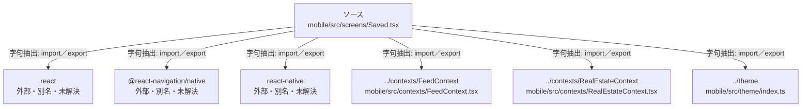

# dependency-map/group-2/n-mobile-src-screens-saved-tsx-bf6e53

[解析トップへ戻る](../../../README.md)

確認済みファイル: `mobile/src/screens/Saved.tsx`

解析: 字句抽出。静的なimport／export参照です。関数の実行順序やHTTP通信は表していません。

宣言: `SavedScreen`

- `react` → 外部・標準ライブラリ・別名など。ローカル対応先は未確定
- `@react-navigation/native` → 外部・標準ライブラリ・別名など。ローカル対応先は未確定
- `react-native` → 外部・標準ライブラリ・別名など。ローカル対応先は未確定
- `../contexts/FeedContext` → `mobile/src/contexts/FeedContext.tsx`（内容確認済み）
- `../contexts/RealEstateContext` → `mobile/src/contexts/RealEstateContext.tsx`（内容確認済み）
- `../theme` → `mobile/src/theme/index.ts`（内容確認済み）

## 要素の説明

### n-contexts-feedcontext-f1fb84

参照名: `../contexts/FeedContext`

対応する実在ソース: `mobile/src/contexts/FeedContext.tsx`。内容確認済み。

### n-contexts-realestatecontext-b4d36f

参照名: `../contexts/RealEstateContext`

対応する実在ソース: `mobile/src/contexts/RealEstateContext.tsx`。内容確認済み。

### n-react-6b810c

参照名: `react`

ローカルのソース対応先を確定できませんでした。外部ライブラリ、標準ライブラリ、型別名などを区別する追加確認が必要です。

### n-react-native-5c4a38

参照名: `react-native`

ローカルのソース対応先を確定できませんでした。外部ライブラリ、標準ライブラリ、型別名などを区別する追加確認が必要です。

### n-react-navigation-native-f8232c

参照名: `@react-navigation/native`

ローカルのソース対応先を確定できませんでした。外部ライブラリ、標準ライブラリ、型別名などを区別する追加確認が必要です。

### n-theme-aece7d

参照名: `../theme`

対応する実在ソース: `mobile/src/theme/index.ts`。内容確認済み。

### source

`mobile/src/screens/Saved.tsx` の内容を確認しました。

