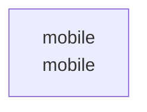

# overall-architecture

[解析トップへ戻る](../README.md)

# swipe-estate

Expo／React Nativeによる物件アプリ。画面ナビゲーション、認証、物件データのContextを確認しました。

この図はリポジトリ内の構成です。コードを実行した結果やサービス間の通信保証ではありません。

## 対象と根拠

対象: https://github.com/FORIFOR/swipe-estate

取得ブランチ: `main`

Git tree SHA: `d45cb7cc5d2884d184833bc389f9920565c71584`

ファイル一覧: 100件。内容確認: 18件。全ファイルの意味解析ではありません。

## 解析の制約

実コードの取得は入口、マニフェスト、直接参照先を中心とする初回解析です。動的ロード、実行時設定、別リポジトリとの接続、ローカル未コミット変更は未確認です。

## 確認が必要な点

構成図の配置関係と、実際の通信・呼び出し関係を区別してください。README上の機能や精度の記述は動作検証済みという意味ではありません。

## 追加解析

未読の中核モジュールから処理順序・データ保存・状態遷移を追加解析する。実行環境で通信先と機能フラグを照合する。

## 補足

2026-10-11の初回解析スナップショットです。現在のコードとの差分や実行環境は追加確認が必要です。

## 要素の説明

### n-mobile-83d631

確認したパス: `mobile`。配下の登録ファイルは97件。

- `mobile/.env`（一覧のみ）
- `mobile/.gitignore`（一覧のみ）
- `mobile/.npmrc`（一覧のみ）
- `mobile/App.tsx`（内容確認済み）
- `mobile/android/.gitignore`（一覧のみ）
- `mobile/android/app/build.gradle`（一覧のみ）
- `mobile/android/app/debug.keystore`（一覧のみ）
- `mobile/android/app/proguard-rules.pro`（一覧のみ）
- `mobile/android/app/src/debug/AndroidManifest.xml`（一覧のみ）
- `mobile/android/app/src/main/AndroidManifest.xml`（一覧のみ）
- `mobile/android/app/src/main/java/com/mobile/MainActivity.kt`（一覧のみ）
- `mobile/android/app/src/main/java/com/mobile/MainApplication.kt`（一覧のみ）
- `mobile/android/app/src/main/res/drawable-hdpi/splashscreen_logo.png`（一覧のみ）
- `mobile/android/app/src/main/res/drawable-mdpi/splashscreen_logo.png`（一覧のみ）
- `mobile/android/app/src/main/res/drawable-xhdpi/splashscreen_logo.png`（一覧のみ）
- `mobile/android/app/src/main/res/drawable-xxhdpi/splashscreen_logo.png`（一覧のみ）
- `mobile/android/app/src/main/res/drawable-xxxhdpi/splashscreen_logo.png`（一覧のみ）
- `mobile/android/app/src/main/res/drawable/ic_launcher_background.xml`（一覧のみ）
- `mobile/android/app/src/main/res/drawable/rn_edit_text_material.xml`（一覧のみ）
- `mobile/android/app/src/main/res/mipmap-hdpi/ic_launcher.webp`（一覧のみ）
- `mobile/android/app/src/main/res/mipmap-hdpi/ic_launcher_round.webp`（一覧のみ）
- `mobile/android/app/src/main/res/mipmap-mdpi/ic_launcher.webp`（一覧のみ）
- `mobile/android/app/src/main/res/mipmap-mdpi/ic_launcher_round.webp`（一覧のみ）
- `mobile/android/app/src/main/res/mipmap-xhdpi/ic_launcher.webp`（一覧のみ）
- `mobile/android/app/src/main/res/mipmap-xhdpi/ic_launcher_round.webp`（一覧のみ）
- `mobile/android/app/src/main/res/mipmap-xxhdpi/ic_launcher.webp`（一覧のみ）
- `mobile/android/app/src/main/res/mipmap-xxhdpi/ic_launcher_round.webp`（一覧のみ）
- `mobile/android/app/src/main/res/mipmap-xxxhdpi/ic_launcher.webp`（一覧のみ）
- `mobile/android/app/src/main/res/mipmap-xxxhdpi/ic_launcher_round.webp`（一覧のみ）
- `mobile/android/app/src/main/res/values/colors.xml`（一覧のみ）
- `mobile/android/app/src/main/res/values/strings.xml`（一覧のみ）
- `mobile/android/app/src/main/res/values/styles.xml`（一覧のみ）
- `mobile/android/build.gradle`（一覧のみ）
- `mobile/android/gradle.properties`（一覧のみ）
- `mobile/android/gradle/wrapper/gradle-wrapper.jar`（一覧のみ）

[詳細な図と説明を見る](n-mobile-83d631/README.md)

