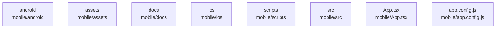

# overall-architecture/n-mobile-83d631/group-1

[解析トップへ戻る](../../../README.md)

このグループは表示用の区切りです。独立した実行モジュールではありません。

## 要素の説明

### n-mobile-android-b97137

実在パス: `mobile/android`。35ファイル。

- `mobile/android/.gitignore`
- `mobile/android/app/build.gradle`
- `mobile/android/app/debug.keystore`
- `mobile/android/app/proguard-rules.pro`
- `mobile/android/app/src/debug/AndroidManifest.xml`
- `mobile/android/app/src/main/AndroidManifest.xml`
- `mobile/android/app/src/main/java/com/mobile/MainActivity.kt`
- `mobile/android/app/src/main/java/com/mobile/MainApplication.kt`
- `mobile/android/app/src/main/res/drawable-hdpi/splashscreen_logo.png`
- `mobile/android/app/src/main/res/drawable-mdpi/splashscreen_logo.png`
- `mobile/android/app/src/main/res/drawable-xhdpi/splashscreen_logo.png`
- `mobile/android/app/src/main/res/drawable-xxhdpi/splashscreen_logo.png`
- `mobile/android/app/src/main/res/drawable-xxxhdpi/splashscreen_logo.png`
- `mobile/android/app/src/main/res/drawable/ic_launcher_background.xml`
- `mobile/android/app/src/main/res/drawable/rn_edit_text_material.xml`
- `mobile/android/app/src/main/res/mipmap-hdpi/ic_launcher.webp`
- `mobile/android/app/src/main/res/mipmap-hdpi/ic_launcher_round.webp`
- `mobile/android/app/src/main/res/mipmap-mdpi/ic_launcher.webp`
- `mobile/android/app/src/main/res/mipmap-mdpi/ic_launcher_round.webp`
- `mobile/android/app/src/main/res/mipmap-xhdpi/ic_launcher.webp`
- `mobile/android/app/src/main/res/mipmap-xhdpi/ic_launcher_round.webp`
- `mobile/android/app/src/main/res/mipmap-xxhdpi/ic_launcher.webp`
- `mobile/android/app/src/main/res/mipmap-xxhdpi/ic_launcher_round.webp`
- `mobile/android/app/src/main/res/mipmap-xxxhdpi/ic_launcher.webp`
- `mobile/android/app/src/main/res/mipmap-xxxhdpi/ic_launcher_round.webp`

### n-mobile-app-config-js-0c22e0

実在パス: `mobile/app.config.js`。1ファイル。

- `mobile/app.config.js`

### n-mobile-app-tsx-3eaacb

実在パス: `mobile/App.tsx`。1ファイル。

- `mobile/App.tsx`

### n-mobile-assets-78687d

実在パス: `mobile/assets`。4ファイル。

- `mobile/assets/adaptive-icon.png`
- `mobile/assets/favicon.png`
- `mobile/assets/icon.png`
- `mobile/assets/splash-icon.png`

### n-mobile-docs-64b1a6

実在パス: `mobile/docs`。1ファイル。

- `mobile/docs/supabase-setup.md`

### n-mobile-ios-42cf77

実在パス: `mobile/ios`。16ファイル。

- `mobile/ios/.gitignore`
- `mobile/ios/.xcode.env`
- `mobile/ios/Podfile`
- `mobile/ios/Podfile.lock`
- `mobile/ios/Podfile.properties.json`
- `mobile/ios/mobile.xcodeproj/project.pbxproj`
- `mobile/ios/mobile.xcodeproj/xcshareddata/xcschemes/mobile.xcscheme`
- `mobile/ios/mobile.xcworkspace/contents.xcworkspacedata`
- `mobile/ios/mobile/AppDelegate.swift`
- `mobile/ios/mobile/Images.xcassets/AppIcon.appiconset/Contents.json`
- `mobile/ios/mobile/Images.xcassets/Contents.json`
- `mobile/ios/mobile/Info.plist`
- `mobile/ios/mobile/PrivacyInfo.xcprivacy`
- `mobile/ios/mobile/SplashScreen.storyboard`
- `mobile/ios/mobile/Supporting/Expo.plist`
- `mobile/ios/mobile/mobile-Bridging-Header.h`

### n-mobile-scripts-7d5fe9

実在パス: `mobile/scripts`。2ファイル。

- `mobile/scripts/check-env.js`
- `mobile/scripts/test-auth.js`

### n-mobile-src-b27784

実在パス: `mobile/src`。27ファイル。

- `mobile/src/components/PhoneAuth.tsx`
- `mobile/src/components/PropertyCard.tsx`
- `mobile/src/components/SwipeDeck.tsx`
- `mobile/src/components/TestSwipe.tsx`
- `mobile/src/contexts/AuthContext.tsx`
- `mobile/src/contexts/FeedContext.tsx`
- `mobile/src/contexts/RealEstateContext.tsx`
- `mobile/src/global.d.ts`
- `mobile/src/lib/supabase.ts`
- `mobile/src/navigation/index.tsx`
- `mobile/src/screens/AlertsScreen.js`
- `mobile/src/screens/Home.tsx`
- `mobile/src/screens/InsightsScreen.js`
- `mobile/src/screens/LoginScreen.tsx`
- `mobile/src/screens/MapScreen.js`
- `mobile/src/screens/Profile.tsx`
- `mobile/src/screens/PropertyDetailScreen.tsx`
- `mobile/src/screens/PropertySearchScreen.tsx`
- `mobile/src/screens/PropertySwipeScreen.tsx`
- `mobile/src/screens/RealEstateScreen.tsx`
- `mobile/src/screens/Saved.tsx`
- `mobile/src/screens/Search.tsx`
- `mobile/src/screens/TestAuth.tsx`
- `mobile/src/services/LifullHomesAPI.ts`
- `mobile/src/services/RealEstateAPI.ts`

