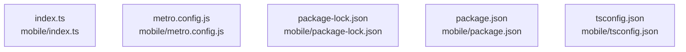

# overall-architecture/n-mobile-83d631/group-2

[解析トップへ戻る](../../../README.md)

このグループは表示用の区切りです。独立した実行モジュールではありません。

## 要素の説明

### n-mobile-index-ts-fd77bf

実在パス: `mobile/index.ts`。1ファイル。

- `mobile/index.ts`

### n-mobile-metro-config-js-1a2393

実在パス: `mobile/metro.config.js`。1ファイル。

- `mobile/metro.config.js`

### n-mobile-package-json-61880d

実在パス: `mobile/package.json`。1ファイル。

- `mobile/package.json`

### n-mobile-package-lock-json-fa2e3c

実在パス: `mobile/package-lock.json`。1ファイル。

- `mobile/package-lock.json`

### n-mobile-tsconfig-json-9895dc

実在パス: `mobile/tsconfig.json`。1ファイル。

- `mobile/tsconfig.json`

